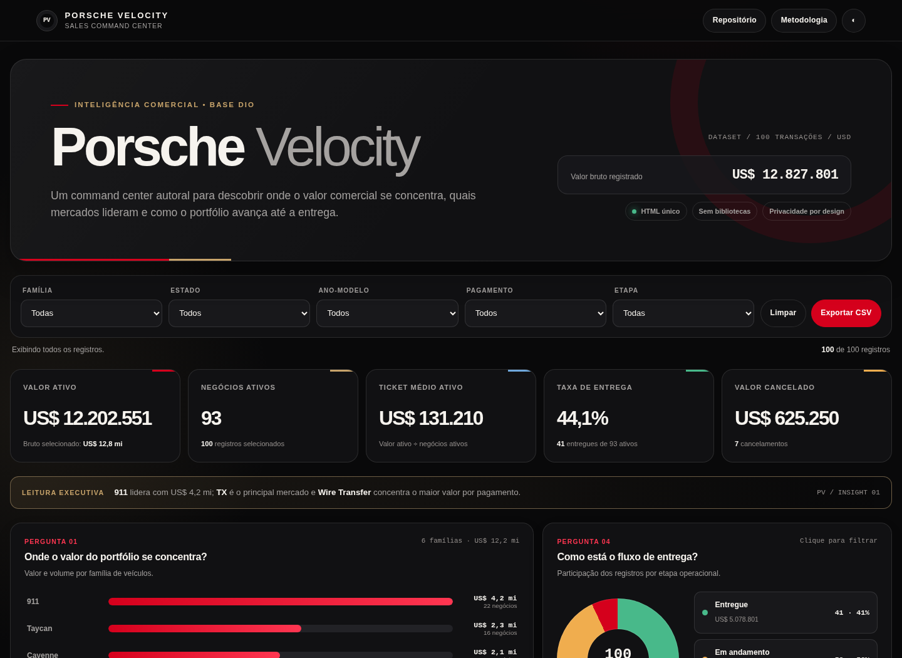
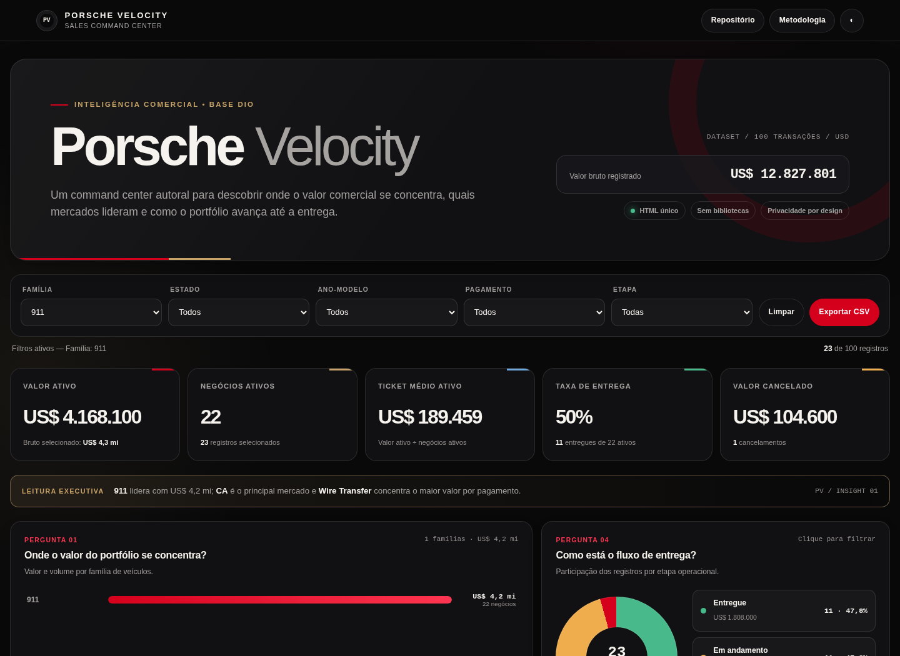

# Porsche Velocity — Sales Command Center

[](https://gabrielnasciimentoleandro-arch.github.io/porsche-sales-command-center/)


Dashboard interativo e autoral desenvolvido para o desafio DIO **“Criando uma Dashboard da Porsche com Agentes de IA”**. O projeto transforma 100 registros da planilha sanitizada em perguntas comerciais claras, sem expor clientes ou depender de bibliotecas externas.

## Acessos

- **Dashboard publicado:** https://gabrielnasciimentoleandro-arch.github.io/porsche-sales-command-center/
- **Arquivo único:** [`index.html`](./index.html)
- **Repositório:** https://github.com/gabrielnasciimentoleandro-arch/porsche-sales-command-center



## Objetivo

Criar um command center que ajude a entender:

- concentração do valor por família Porsche;
- mercados geográficos mais relevantes;
- comportamento por método de pagamento;
- situação operacional entre entrega, andamento e cancelamento.

A identidade **Porsche Velocity** foi criada do zero para este projeto. O painel não copia o dashboard do professor ou entregas de outros participantes e não utiliza logotipo ou fotografia oficial.

## Perguntas de negócio

| Pergunta | Por que importa | Resposta inicial |
|---|---|---|
| **1. Onde o valor do portfólio se concentra?** | Orienta mix, estoque e prioridade comercial | A família **911** lidera com **US$ 4.168.100,00**, 34,2% do valor ativo |
| **2. Quais mercados lideram?** | Apoia alocação regional e campanhas | **Texas (TX)** lidera com **US$ 2.023.400,50** |
| **3. Como os clientes pagam?** | Ajuda a planejar meios de pagamento e experiência de compra | **Wire Transfer** concentra **US$ 3.979.450,00** |
| **4. Como está o fluxo de entrega?** | Separa desempenho comercial de execução operacional | 41 entregues, 52 em andamento e 7 cancelados |

## Indicadores validados

| Indicador | Resultado |
|---|---:|
| Registros | **100** |
| Valor bruto registrado | **US$ 12.827.800,50** |
| Negócios ativos | **93** |
| Valor ativo | **US$ 12.202.550,50** |
| Ticket médio ativo | **US$ 131.210,22** |
| Taxa de entrega | **44,1%** |
| Valor cancelado | **US$ 625.250,00** |
| Participação elétrica no valor ativo | **22,1%** |

> **Valor ativo** exclui cancelamentos. Essa distinção evita tratar sete negócios cancelados como receita ou carteira vigente.

## Interações

O dashboard oferece:

- cinco filtros: família, estado, ano-modelo, pagamento e etapa;
- barras e legenda clicáveis como atalhos de filtro;
- limpeza completa dos filtros;
- exportação da seleção para CSV;
- tema escuro e claro;
- leitura executiva recalculada;
- ranking agregado de modelos;
- diálogo com metodologia e regras;
- layout responsivo para computador e celular.

### Exemplo: família 911



O filtro retorna 23 registros, 22 negócios ativos, US$ 4.168.100,00 de valor ativo e ticket médio de US$ 189.459,00.

## Tratamento dos dados

A planilha contém cada informação em duas versões: dado cru e dado sanitizado. Somente as colunas sanitizadas foram usadas.

| Dimensão | Coluna utilizada |
|---|---|
| Modelo | `PorscheModelSanitized` |
| Ano-modelo | `ModelYearSanitized` |
| Preço | `SalesPriceSanitized` |
| Quilometragem | `VehicleMileageSanitized` |
| Pagamento | `PayMethodSanitized` |
| Cidade | `CitySanitized` |
| Estado | `StateSanitized` |
| Situação | `DeliveryStatusSanitized` |

Também foram criadas três dimensões:

- **família:** 911, 718, Cayenne, Macan, Taycan e Panamera;
- **etapa:** Entregue, Em andamento ou Cancelado;
- **motorização:** Combustão, Elétrico ou Híbrido.

### Privacidade por design

Antes de gerar o HTML e o CSV público, foram removidos:

- ID da venda;
- nome do cliente;
- nome do vendedor;
- todas as colunas cruas;
- datas individualizadas.

O dashboard público incorpora apenas 11 campos analíticos e não faz qualquer chamada de rede.

### Por que a data não virou gráfico

A coluna sanitizada possui **24 valores `INVALID`**. As 76 datas restantes vão de 14/03/2024 a 01/10/2027 e incluíam 21 registros futuros na data de geração. Para não apresentar uma tendência temporal enganosa, as datas foram excluídas dos KPIs e do HTML.

Detalhes: [`docs/METODOLOGIA.md`](./docs/METODOLOGIA.md).

## Prompt e refinamento

O prompt orientador pediu a um agente que:

> auditasse a base, removesse campos identificáveis, definisse quatro perguntas de negócio e produzisse um dashboard autoral em um único HTML, sem API, CDN ou backend, com cinco filtros, métricas que não tratassem cancelamentos como valor ativo, identidade premium, responsividade e validação automatizada.

A primeira ideia de “mostrar vendas por modelo, cidade e pagamento” foi refinada para:

1. formular perguntas antes de escolher os gráficos;
2. separar valor bruto, ativo e cancelado;
3. retirar a dimensão temporal inconsistente;
4. agrupar 40 modelos em seis famílias;
5. minimizar os dados incorporados;
6. substituir bibliotecas por componentes nativos;
7. adicionar filtros por clique, CSV, mobile e acessibilidade;
8. validar cálculos e comportamento em navegador real.

O prompt completo e o histórico de decisões estão em [`docs/PROMPT.md`](./docs/PROMPT.md).

## Como a IA foi utilizada

Foi usado **um agente com ferramentas e skill própria**, no Arena.ai Agent Mode. O projeto não utilizou ChatGPT Canvas.

O agente apoiou:

- auditoria e cálculo independente da planilha;
- definição e revisão das perguntas;
- implementação do HTML, CSS e JavaScript;
- testes de filtros, exportação, mobile e console;
- auditoria de acessibilidade;
- documentação e preparação do deploy.

A skill reutilizável está em [`skills/porsche-dashboard/SKILL.md`](./skills/porsche-dashboard/SKILL.md).

## Tecnologia e arquitetura

- HTML5, CSS3 e JavaScript puro;
- dados incorporados no próprio `index.html`;
- nenhum framework ou gráfico de terceiros;
- nenhuma API, backend, cookie ou armazenamento local;
- Content Security Policy com conexões de rede bloqueadas;
- Python e `openpyxl` somente para preparação e validação;
- hospedagem gratuita no GitHub Pages.

O arquivo funciona diretamente no navegador e não exige servidor para uso local.

## Como executar

### Abrir o resultado

Baixe `index.html` e abra no navegador.

### Reproduzir desde a fonte

```bash
git clone https://github.com/gabrielnasciimentoleandro-arch/porsche-sales-command-center.git
cd porsche-sales-command-center
python -m venv .venv
```

Ative o ambiente:

```bash
# Windows
.venv\Scripts\activate

# Linux/macOS
source .venv/bin/activate
```

Instale e execute:

```bash
pip install -r requirements.txt
python scripts/gerar_dashboard.py
python scripts/verificar_dashboard.py
```

O gerador baixa a planilha oficial quando ela não está disponível, verifica seu SHA-256, cria a base pública minimizada e atualiza `index.html`.

## Estrutura

```text
porsche-sales-command-center/
├── data/
│   ├── porsche_sales_public.csv
│   └── quality-summary.json
├── docs/
│   ├── dashboard-capa.png
│   ├── dashboard-filtro-911.png
│   ├── dashboard-geral.png
│   ├── dashboard-mobile.png
│   ├── METODOLOGIA.md
│   ├── PROMPT.md
│   └── VALIDACAO.md
├── scripts/
│   ├── gerar_dashboard.py
│   └── verificar_dashboard.py
├── skills/porsche-dashboard/SKILL.md
├── src/index.template.html
├── .nojekyll
├── CHECKSUMS.sha256
├── index.html
├── requirements.txt
├── LICENSE
└── README.md
```

`data/source/` guarda a planilha original somente no ambiente local e está fora do Git por privacidade e minimização.

## Validação

A verificação automatizada confirma:

- 100 registros derivados das colunas sanitizadas;
- totais financeiros e distribuições conhecidas;
- nenhuma informação de cliente ou vendedor no dataset público;
- sintaxe JavaScript válida;
- ausência de CDN, bibliotecas e chamadas de rede;
- funcionamento de filtros, reset, CSV, temas e metodologia;
- zero erros no console;
- visual móvel sem overflow;
- zero violações críticas ou sérias no axe-core, em ambos os temas.

Relatório: [`docs/VALIDACAO.md`](./docs/VALIDACAO.md).

## Fonte e integridade

Base oficial do desafio: [Planilha base Porsche (sanitizada)](https://hermes.dio.me/files/assets/8683bed0-cc33-4e06-bca9-04db9c31f9e2.xlsx)

```text
SHA-256: f874650657ca4e1a99fd4462b297bfc5fd9915e8e693956d9cec47eda2cb2e2d
```

Os hashes dos artefatos públicos estão em [`CHECKSUMS.sha256`](./CHECKSUMS.sha256).

A planilha original não é publicada neste repositório. O CSV público contém somente campos necessários e não identificáveis.

## Limitações

- os 100 registros formam uma base educacional, não dados corporativos oficiais;
- a baixa amostra por algumas cidades e estados limita generalizações;
- datas não foram usadas devido às inconsistências documentadas;
- preços representam valores registrados na base e não cotações atuais;
- resultados não representam a Porsche ou suas operações reais.

## Autor

**0Barone** — [@gabrielnasciimentoleandro-arch](https://github.com/gabrielnasciimentoleandro-arch)

## Licença

Código, documentação, skill e identidade autoral são disponibilizados sob a [Licença MIT](./LICENSE). A planilha-fonte permanece sujeita aos termos da DIO e de seus responsáveis.

---

Porsche é marca de seu respectivo proprietário. Este é um projeto educacional independente, sem afiliação ou endosso.
